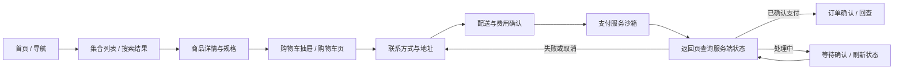

# E-pig 全站优化与沙箱交易闭环需求文档

更新日期：2026-11-02

状态：approved with reviewed scope — 已批准评审后的精简方案，执行中

版本：0.2.0

需求分支：`codex/storefront-end-to-end-requirements`

盘点基线：`feat/skill-test` / `4f30a6a36058ab565c36cdc512729da18b73ed65`

> 2026-11-02 用户批准按讨论方案执行。本文保留需求评审基线；对应范围以 [已确认契约](./contracts.md) 和 [实施任务](./TASKS.md) 为准，旧文“待审核/建议”不代表重复请求批准。优惠码、新筛选、旧车迁移、Blog 详情与库存预留已按评审延后。

## 1. 目标与已确认边界

将现有家具电商演示站完善为设计统一、主要入口可用、交易状态可信的沙箱商城。顾客能够完成 **浏览 → 搜索/列表 → 详情选规格 → 加购 → 购物车 → 地址与配送 → 订单金额确认 → 沙箱支付 → 订单确认与回查**。

| 项目 | 结论 | 来源 / 状态 |
| --- | --- | --- |
| 工作方式 | 新建分支；先交需求文档，审核后再推进 | 用户已确认 |
| 交易终点 | 沙箱支付成功，并生成可回查订单 | 用户已确认 |
| 市场 | AU 完整闭环；SG、US 做路由、币种、购物车隔离兼容检查 | 用户已确认 |
| 设计依据 | 当前 `DESIGN.md`、happy-dog 设计系统 JSON 与运行时 tokens | 用户要求；仓库现有契约 |
| 应用架构 | 保留单 Next.js App、ports/adapters、市场前缀与缓存边界 | 项目 Hard Rules |
| 支付方向 | 沿用仓库路线图的 Stripe sandbox；具体支付页面形态待审 | 仓库已有提案，并非本轮用户单独确认 |

**完成定义：** AU 顾客在桌面和移动端完成一笔由支付服务沙箱确认的交易，服务端持久保存对应订单；刷新、重新打开以及服务重启后，授权访问者仍可查询该订单。失败、取消、超时与重复提交均有明确结果和恢复入口。

纯模拟“支付成功”、前端写入 `paid`、仅打开成功页、只运行内存订单，均不满足上述完成定义。沙箱验收不代表正式收款、真实库存、物流履约或生产上线已验收。

## 2. 现状与缺口

以下为基线代码与本地文档的静态盘点；本轮未运行页面、支付或部署验收。历史 PRD 的 `done` / `proposal` 不替代当前代码证据。

| 区域 | 当前证据 | 本轮需求需要补齐 |
| --- | --- | --- |
| 首页与全局导航 | 有首页、分类、商品卡片、桌面 Mega Menu 与移动导航 | 统一视觉与信息层级，校验每个可见入口的真实去向 |
| 商品列表 PLP | 有集合页、价格/名称排序、空态、metadata | 搜索复用列表；筛选和结果状态；可售与变体约束一致 |
| 商品详情 PDP | 有图库、颜色按钮、库存文案与加购；颜色无独立 SKU/variantId | 建立可交易变体；消除不同颜色合并到同一购物车行的问题 |
| 详情页设计 | 存在硬编码蓝色 CTA、独立色值、固定高度与无事件的工具按钮 | 回归 happy-dog；长内容可展示；所有操作具有实际行为 |
| 搜索 | Header 搜索按钮禁用；catalog adapter 有 `suggest`，没有搜索路由 | 搜索入口、结果页、清空、无结果和异常状态 |
| 购物车 | 页面使用按市场隔离的 localStorage cart；mock CartPort 使用进程内 Map | 服务端权威购物车、匿名会话、持久化、并发处理、独立购物车页 |
| 结算 | 抽屉内按钮为禁用的 `Checkout requires backend`；没有 checkout 路由 | 地址、配送、费用计算、订单检查、支付发起与恢复 |
| 支付与订单 | 当前 core contract 只有 catalog/cart；未发现 payment、checkout、order 实现 | 支付/结算/订单契约、持久存储、支付结果处理与授权查单 |
| 内容与页脚 | 有 Blog 列表；详情入口为禁用文案；页脚链接为 `#` | 统一 Blog 视觉；补内容去向和购买所需帮助页；清理无效入口 |
| 商品数据 | Koala 展示 fixtures；SG/US 为演示估算价格；图库有重复图兜底、评分有默认值 | 可辨识的沙箱数据；明确变体/库存/评分来源；避免伪装成真实评价或库存 |
| 测试与环境 | 有 Vitest；未发现 E2E 目录；有 standalone 与 Cloudflare 构建脚本 | 补交易集成测试和浏览器全链路证据；选定可持久化的验收环境 |

代码证据入口见 §13。上述缺口表示“尚不满足目标”，不将未运行的场景描述为已复现故障。

## 3. 首轮范围与非目标（待整体审核）

### 3.1 必须交付的范围

- 全站设计一致性：首页、列表、详情、Blog、购物车、结算、订单结果、帮助与错误页面。
- 主购物链路：搜索、必要筛选、真实的沙箱变体选择、服务端购物车、游客结算、配送与费用明细、沙箱支付、订单回查。
- 全局入口治理：每个保留的链接和按钮有明确目的地或可理解的当前状态；不保留“看似可点击但无行为”的功能。
- 交易保障：服务端校价、库存校验、幂等、支付异步确认、持久化、订单访问控制、失败恢复。
- 桌面/移动端、键盘操作、空态/加载/错误态，以及 AU 主链路和 SG/US 兼容回归。

### 3.2 建议延后或有条件纳入

| 能力 | 建议 | 审核后处理 |
| --- | --- | --- |
| 登录、注册、会员中心、地址簿 | 首轮使用游客结算 | 隐藏尚不可用账号入口；若必须首轮交付，增加身份与订单归属需求 |
| 收藏、商品比较、快捷预览 | 首轮不新增 | 移除当前无行为按钮；后续有独立需求再开放 |
| 优惠码 | 首轮做单码、不叠加的沙箱规则 | 优惠类型、门槛、上限等仍待确认；未批准则不展示输入入口 |
| Blog 详情 | 建议补最小本地内容详情 | 不引入 CMS；若延后，移除详情诱导并明确列表阅读方式 |
| 跨设备查单、邮件确认 | 首轮建议以同浏览器游客凭证回查为最低范围 | 跨设备恢复需要额外的邮箱验证或登录方案，不能仅凭订单号+邮箱放行 |
| SG/US 完整支付与配送 | 本轮不要求 | 只做已确认兼容检查；未验收市场不开放支付入口 |

### 3.3 本轮不包含

真实扣款、生产上线、真实商品/订单后台对接、库存仓配系统、税务引擎、退款退货自动化、订阅支付、多支付服务、后台管理、会员营销与多语言扩展。全站优化不意味着自动补齐这些业务系统。

现有展示商品可以继续用于沙箱浏览；交易用 SKU、价格、库存及政策使用经过确认的测试数据。允许保留展示数据与交易测试数据的区别，但购买按钮必须明确该商品是否可完成沙箱交易。

## 4. 用户旅程与页面地图

| 页面 / 入口 | 拟定路由 | 主业务域 | 核心结果 |
| --- | --- | --- | --- |
| 首页 | `/{market}` | content，协作 catalog | 找到商品或分类 |
| 集合列表 | `/{market}/collections/{slug}` | catalog | 筛选排序后进入商品 |
| 搜索 | `/{market}/search?q=...` | catalog | 得到相关结果或可恢复空态 |
| 商品详情 | `/{market}/products/{slug}` | catalog，协作 cart | 明确规格、价格、可售状态并加购 |
| 购物车页 | `/{market}/cart` | cart | 核对行项目与金额，进入结算 |
| 结算 | `/{market}/checkout` | checkout | 保存地址、选择配送、确认报价并发起支付 |
| 支付返回 | `/{market}/checkout/return` | checkout，协作 order | 查询服务端状态，显示处理中/结果 |
| 订单详情 | `/{market}/orders/{orderId}` | order | 在访问凭证校验后读取持久订单 |
| 我的沙箱订单 | `/{market}/orders` | order | 找回当前游客会话拥有的订单；范围待 D02 审核 |
| Blog 列表/详情 | `/{market}/blog`、`/{market}/blog/{slug}` | content | 阅读现有内容；详情范围待 D04 审核 |
| 帮助与政策 | `/{market}/help/{slug}` | content | 配送、退换、FAQ、联系与政策信息 |

路由为需求草案，最终文件布局留到需求批准后的技术方案。`/` 与其它市场前缀仍遵循本进程 `MARKET` 的规范化规则；一个 AU 进程不视为同时开放三市场。结算可以使用单页分组与渐进展开，不要求新增多步骤路由。

## 5. 视觉与交互要求

| ID | 要求 | 验收方式 |
| --- | --- | --- |
| UI-01 | 品牌色、背景、正文色使用现有语义 token；主 CTA 对应 moss-700，底色对应 cream-200；不在业务 UI 新增任意 hex/oklch | 对照 `DESIGN.md` 与 happy-dog；检查 PDP、Blog 和新增页面一致性 |
| UI-02 | 采用现有 sans/display 字体与圆角体系；按钮、输入、选择、错误提示、数量控件复用 happy-dog | 组件状态及页面并排验收；产品色卡数据不作为任意 UI 配色依据 |
| UI-03 | 商品、价格、规格、购买动作的层级清晰；首页围绕真实商品/家居场景；结算减少无关营销 | 首页、PDP、Cart、Checkout 页面评审 |
| UI-04 | 长商品名、长地址、表单报错与放大文字不被固定高度裁切；订单摘要与付款按钮可完整访问 | 375 / 768 / 1440 px 检查；320 px 无横向页面溢出；200% 文字缩放检查 |
| UI-05 | 移动端选择规格、改数量、填地址与支付动作可触达；固定底栏不遮挡内容、软键盘和错误信息 | 移动浏览器实际操作；关键触控区建议至少 44×44 CSS px |
| UI-06 | 键盘可完成主要操作；焦点可见；抽屉/弹窗关闭后焦点返回触发点；表单 label 与错误关联；不只用颜色表达状态 | 键盘完整旅程与组件测试；只挂载一个购物车抽屉 |
| UI-07 | loading/disabled/empty/error/success 状态有统一样式；重要异步结果可被辅助技术感知 | 状态矩阵与 stories/组件测试 |
| UI-08 | 动效少量且有目的，尊重 reduced-motion；图片预留尺寸、主图优先加载、失败有兜底 | 页面检查及图片异常场景 |
| UI-09 | 用户文案描述购物与沙箱状态；移除技术栈、后端实现方式等开发说明；测试付款前明确“不会真实扣款” | 内容检查；沙箱标识保留，避免误认正式营业 |

`DESIGN.md` 自身仍标记 proposal。本次按用户要求将其和已实现 tokens 作为工作依据，不擅自改为 accepted。未有整页设计稿的 Cart/Checkout/Order 需在下一阶段补页面布局与状态设计，再按本需求验收。

## 6. 功能需求与验收标准

### 6.1 全局壳、首页与内容

| ID | 需求 | 验收标准 |
| --- | --- | --- |
| NAV-01 | 导航、首页分类/精选、页脚路径统一带市场前缀 | 所有保留入口落到有效页面或存在的锚点；无 `href="#"` 占位；未知路由有返回购物入口 |
| NAV-02 | 搜索、购物车、移动导航可使用 | 搜索可提交；购物车数量随服务端状态更新；切页关闭菜单但保留购物数据 |
| NAV-03 | 账号/收藏/预览按批准范围显示 | 未实现能力不伪装成可用操作；PDP 不保留无事件图标按钮 |
| CNT-01 | 帮助、配送、退换、联系、隐私/条款具备有效去向 | 使用批准内容或明确沙箱说明；不虚构客服地址、配送时效、试睡承诺或真实用户评价 |
| CNT-02 | Blog 沿用全站设计；保留的“阅读详情”必须可达 | 本地文章可读且能返回列表；无正文或来源的卡片不伪装成完整文章 |

### 6.2 列表、搜索与详情

| ID | 需求 | 验收标准 |
| --- | --- | --- |
| CAT-01 | 列表展示一致的商品名、图片、市场价格、可售信息和详情入口 | 有商品、空集合、失效集合、上游错误均有明确结果；无价格的项目不得直接进入支付 |
| CAT-02 | 排序与基本筛选 | 保留价格升降序和名称排序；建议首轮加入价格区间、可售状态，搜索另可按类目筛选；URL 可还原状态，清空筛选可恢复结果，非法参数有稳定兜底 |
| CAT-03 | 搜索从 Header 发起并支持分享/刷新 | 支持关键词提交、空词引导、命中、无结果、清空与请求失败；结果复用列表商品契约；查询参数正确编码 |
| PDP-01 | 详情信息完整且不截断 | 主图/缩略图、名称、描述、材质、价格、规格、库存、配送帮助可访问；单图不伪造不同视角；无有效评分时隐藏评分 |
| PDP-02 | 规格对应唯一可售变体 | 至少一个测试商品包含两种可区分变体；所选 variantId/SKU、价格、图片、库存和购物车信息一致；不能只改变颜色标签 |
| PDP-03 | 加购条件一致 | 多规格必须完成有效选择；单规格可直接加购；缺货/下架/超库存禁加；列表快捷加购不能绕过选规格与库存校验 |
| PDP-04 | 加购反馈可恢复 | 请求中防误操作，成功显示已添加规格与数量，失败保留选择并允许重试；不能仅靠按钮禁用防重复 |

### 6.3 购物车

| ID | 需求 | 验收标准 |
| --- | --- | --- |
| CART-01 | 服务端持有权威购物车，客户端只保存访问凭证与展示状态 | 首次 mutation 创建 cart 并签发签名 cookie；普通 GET 不创建；刷新、重新打开和服务重启后恢复；localStorage 价格不作为报价依据；所有读取与 mutation 校验游客凭证、资源归属和市场，不能仅凭 cartId 操作 |
| CART-02 | 抽屉与购物车页使用同一份状态 | 同变体合并数量、不同变体分行；增减、移除、空车继续购物可用；Header 数量、抽屉、页面金额一致 |
| CART-03 | 并发、重复请求与失效会话有定义 | 相同操作的重试只执行一次；两次有意加购都计入；并发首次加购不丢商品；过期/损坏 cookie 不泄露或错误挂接其它购物车 |
| CART-04 | 金额与商品变更反馈 | 价格/库存变化由服务端重新计算；显示变更原因；缺货或数量受限时可调整；未解决冲突不可支付 |
| CART-05 | 优惠码与费用明细 | 若 D06 批准优惠码，支持应用、移除、无效/过期/不满足门槛；不静默接受无效码；未知配送费显示“待地址确认”，不显示为免费 |
| CART-06 | 旧 demo cart 迁移 | 建议仅在明确 mutation 中按一次性幂等导入；服务端重查商品/变体/价格，无法映射规格时提示重选；成功后才清理旧数据，不双写两套购物车 |

### 6.4 结算

| ID | 需求 | 验收标准 |
| --- | --- | --- |
| CHK-01 | 游客结算 | 无需强制注册；空车进入 checkout 时引导返回购物；联系方式与地址有必填、格式和服务端校验；错误定位到字段且保留其它有效输入 |
| CHK-02 | AU 地址与配送 | 可输入姓名、邮箱、地址、城市、州/地区、邮编和配送所需联系方式；字段与可配送区域按 D05 冻结；不支持区域明确阻止支付并提供修改入口 |
| CHK-03 | 配送选择与总额确认 | 至少一种沙箱配送；展示费用与沙箱时效说明；更改地址/配送/商品后重新报价，旧报价不能直接付款 |
| CHK-04 | 单一服务端金额真源 | 折扣、配送、税额及 payable total 逐项展示；币种一致；按批准的含税/未税规则计算，已含税额不能再加一次；前端篡改金额无效 |
| CHK-05 | 安全提交与恢复 | checkout 读取、修改与支付发起均由服务端校验当前游客凭证、资源归属和市场；提交前再次校验 cart/报价版本与可售状态；重复点击、超时重试不创建重复订单/支付；返回上一步保留数据；修改已提交内容需建立新有效报价并隔离旧支付尝试 |
| CHK-06 | 表单数据保存边界 | 个人信息仅用于本次结算和授权查单；不进入 URL、公开缓存、前端日志或埋点；保存时长与清理规则在技术方案中明确 |

### 6.5 沙箱支付与订单

| ID | 需求 | 验收标准 |
| --- | --- | --- |
| PAY-01 | 真实调用支付服务 sandbox | 使用测试凭据和测试支付方式；服务端创建支付会话并关联唯一订单/checkout/金额/币种；缺少沙箱配置时明确不可支付，不伪造成功 |
| PAY-02 | 最终状态来自可信服务端确认 | 校验支付回调真实性和关联数据；返回 URL 只触发查询；伪造成功参数不能将订单改成 paid；金额/币种/订单不匹配不推进订单 |
| PAY-03 | 异步、重复与乱序处理 | 回调先于/晚于浏览器返回都正确；重复事件无重复订单或副作用；终态不被旧事件回退；处理中显示刷新/恢复入口 |
| PAY-04 | 支付失败、取消和超时 | 拒绝付款保留购物上下文并允许重试；取消返回结算；网络未知结果先查状态，不直接发起第二笔；迟到的成功能收敛为一笔有效支付 |
| PAY-05 | 浏览器关闭与服务故障 | 支付完成后关闭页面仍能由服务端确认；回调期间故障后有可重放/补查恢复手段；不得因通知邮件或埋点失败改变已支付订单结果 |
| ORD-01 | 订单持久化与快照 | 保存商品/规格/单价/数量/折扣/运费/税费/总额/币种/地址/状态；商品后续改价不修改历史订单；刷新及服务重启不丢失 |
| ORD-02 | 确认页与回查 | 展示订单号、支付状态、商品摘要和费用；可继续购物和再次查询；paid 不展示成已发货；pending/failed/expired 有可理解说明 |
| ORD-03 | 游客授权访问 | 订单号不作为访问密码；服务端校验会话或专用凭证及市场归属；其它浏览器/会话/市场不能读取订单个人信息；无权限与无此单不泄露详情 |
| ORD-04 | 支付后的购物车处理 | 只处理该次结算快照对应的购买数量；付款过程中新增不同商品或追加同规格数量均不能被误清。例如结算 A 规格 1 件、付款中又加 A 规格 1 件，付款后仍保留后加的 1 件；返回/回调重复发生也不二次清理或重复确认 |

## 7. 关键状态与数据规则

### 7.1 面向用户的支付状态

| 状态 | 页面表现 | 允许的下一步 |
| --- | --- | --- |
| 待付款 / checkout 有效 | 显示当前报价及支付入口 | 发起支付，或返回修改后重新报价 |
| 确认中 / 结果未知 | 明确尚未确认，不展示“付款失败”或“支付成功” | 查询/补查；达到等待阈值提供恢复入口，阈值下一阶段确定 |
| 支付成功 | 显示服务端已确认订单 | 回查、继续购物；不能再次付款 |
| 某次支付失败 / 用户取消 | 解释该次尝试结果；订单不误标为 paid | 校验当前状态后重新支付或修改购物车 |
| 报价/会话过期 | 说明需要重新确认价格与配送 | 重新报价；不可复用过期会话付款 |

订单与支付尝试分开建模：同一订单可有多次失败尝试，但最多一次有效收款结果。取消页面不等于支付服务已取消；新的尝试开启前必须确认旧尝试状态，无法撤销的迟到成功需要有可追踪的冲突处理，不允许双付被静默忽略。具体状态机和并发方案在技术设计中冻结。

### 7.2 价格、库存与测试数据

- 当前 `Money.amount` 表示主单位金额；下一阶段必须定义与支付最小货币单位的转换、精度、舍入和负数边界，并测试防止 100 倍金额错误。不得直接把现有字段当“分”传给支付服务。
- 服务端根据 variantId、数量、市场、地址与已批准规则重新计算报价；客户端提供的价格、优惠额、运费不可作为真源。
- 沙箱商品应至少覆盖单规格、多规格不同价格、缺货、数量受限、长标题和图片缺失；不能把展示用颜色按钮直接当作真实库存 SKU。
- 提交支付前校验库存；沙箱也必须定义并发下单与超卖处理。是否预留及超时释放由下一阶段技术方案选择，不能只依赖页面校验。
- cart、checkout、支付尝试、订单、幂等键及已处理回调记录必须有适配部署环境的持久性。进程内 Map 无法作为最终沙箱验收的数据存储。
- 真实交易源未接入；沙箱成功不得表述为已验证真实库存、正式促销、生产税费或履约能力。

## 8. 工程约束与验收环境

- 保留 `app → modules → core contracts` 的依赖方向；业务 SDK 由 adapter 实现，经 registry 装配；订单通知与埋点作为可降级副作用。
- 所有 request API 按异步调用；不得在共享 `'use cache'` 内读取 cookies/headers。价格、库存、cart、checkout、payment 与私有订单不进入共享缓存。
- typed market registry 是市场/币种/locale 真源；保留市场路径前缀。SG/US 使用各自进程检查，不能仅改 URL 假装切市场。
- 基础组件归 happy-dog，业务组件归 owning domain；按现有组件流程补需求状态、实现、测试和 stories；不进行无关全仓迁移。
- 沿用项目既定 TanStack Query 5、react-hook-form + Zod 的方向；这些前两项尚未出现在当前 package.json 中，具体安装与版本验证留到审核后的计划。
- 付款凭据、cookie 签名密钥和回调密钥只进 server env；不收集或记录原始支付卡信息。沙箱与未来 live 配置明确分离。
- 日志包含脱敏的业务关联标识、状态转换与错误分类，能够定位一次下单；不记录卡信息、完整地址、邮箱、cookie、访问凭证或回调密钥。
- 本地 mock 开发可继续离线运行；沙箱验收必须连接支付服务测试环境。单元 mock 通过不能替代这项证据。
- 仓库同时存在 standalone 与 Cloudflare 支持；最终沙箱验收环境、存储和回调地址尚未选择（D07）。需在目标运行时验收持久化和回调，不能仅凭本地 dev 成功宣称完成。

## 9. 验收矩阵与质量门槛

每项交付记录写明 branch/SHA、市场、设备/视口、环境、测试类型及结果。下表保留需求阶段的验收基线；2026-11-02 实施后的实际结果、范围调整与未通过项见 [验收记录](./acceptance.md)，不再以需求编写时的 NOT RUN 表示当前状态。

| ID | 验收场景 | 预期结果 | 必需证据 |
| --- | --- | --- | --- |
| E01 | 首页 → 列表/搜索 → PDP → 选规格 → 购物车 → 地址/配送 → 沙箱付款 → 订单 | AU 桌面与移动端各完成一笔，金额/币种/规格一致 | 浏览器全链路记录 + 服务端订单 + 沙箱交易关联 |
| E02 | 同商品不同规格加购、调整数量、删除、刷新 | 分行正确，三个 cart 展示入口一致，刷新可恢复 | Vitest 组件/集成 + 浏览器 |
| E03 | 首次并发加购、重复请求、改量竞争、幂等键冲突 | 无丢项、不重复执行、冲突结果明确 | 服务层/adapter 集成测试 |
| E04 | 缺货、价格变化、地址无效、不支持配送 | 提示具体原因并可修正；错误条件不能付款 | 组件/Route Handler/Server Action 集成 |
| E05 | 优惠码无效/过期/移除、含税/未税、舍入和金额篡改 | 若启用优惠则所有分支通过；订单总额与支付额一致 | 纯逻辑与服务端集成测试 |
| E06 | 拒绝付款、额外验证、取消、网络中断 | 失败不误标 paid；数据保留，可安全恢复 | 支付 adapter 集成 + 服务商支持的沙箱浏览器场景 |
| E07 | 回调重复/乱序/延迟、伪造回调、伪造成功 URL、浏览器关闭 | 只有可信匹配结果生效；成功状态不回退，不重复下单 | 回调集成 + 浏览器关闭/返回记录 |
| E08 | 付款过程中新增不同规格、追加相同规格数量，支付返回与回调重复 | 只处理已购数量，所有后加商品/数量保留；不能按 lineId 整行误删 | 集成回归测试 |
| E09 | 服务重启后查单；会话 A 使用会话 B 的有效 cartId/checkoutId/orderId 读取、修改或发起支付；跨市场访问 | 授权订单持久可查；越权读取/修改/支付均拒绝，不泄露个人信息或改变其它会话数据 | 授权集成测试 + 目标验收环境测试 |
| E10 | AU/SG/US 路由、价格、locale 与 cart 隔离 | 每进程符合当前市场；SG/US 不开放未经验收的付款 | 纯函数/集成 + SG/US 运行时 smoke |
| E11 | 主页面、错误页、键盘、长文本、小屏、reduced-motion | 无阻断操作、溢出、遮挡、重复抽屉或 hydration 错误 | 视觉/键盘记录 + 相关组件测试 |
| E12 | 页面图片、加载反馈、全局链接和内容核对 | 无关键破图、死链接、开发占位文案或伪造业务承诺 | 链接清单与浏览器检查 |

测试分层：纯逻辑用 co-located `.spec.ts`；React 可观察交互用 `.spec.tsx`；cart/checkout/payment 使用服务边界集成测试。现阶段无 E2E 基础设施；建议随本交易里程碑引入 Playwright，至少覆盖浏览至 checkout、状态回查和失败恢复；支付服务托管页以实际沙箱操作补证。是否采用及执行环境在技术方案冻结。

实现后的完成门：`pnpm verify`；涉及构建/缓存/部署时另跑 `pnpm build` 与适用的目标运行时 smoke。`verify` 不包含 build、Storybook build 或真实沙箱支付。cart/checkout/payment/跨层实现按 AGENTS.md 启用 Test AI + Review AI，提交 AI Test Record 与 AI Review Record。

性能先建立同条件基线并报告变化；初始目标为关键旅程无阻断、无 hydration/未处理异常、图片尺寸稳定。真实用户性能分位数、转化率改善和财务结果均不属于本轮可证明指标，不用一次本地检查代替。

## 10. 待审核决策

这些建议供本次文档审核。除 §1 两项交互确认和用户原始指令外，均尚未冻结；不同意时可按编号修改。凭据无需写进文档或聊天。

| ID | 决策 | 建议方案 | 不确认的影响 |
| --- | --- | --- | --- |
| D01 | 沙箱支付方式与页面形态 | 沿用 Stripe sandbox，优先托管支付页面；本站保留地址、配送、报价与订单体验 | 影响 UI 边界、支付 adapter、回调、账号与测试条件；接入前需确认可用测试账号 |
| D02 | 游客与订单回查范围 | 游客结算；同浏览器有效凭证可列出/打开自己的订单；跨设备恢复延后 | 影响身份模型、cookie 有效期和恢复方式；清除凭证后不能承诺自动找回 |
| D03 | 商品与交易数据来源 | 保留现有展示目录；补受控沙箱 SKU/价格/库存；未完成交易映射的商品不开放购买 | 若要真实 commerce 后台，需另定来源、权限和接口，扩大范围 |
| D04 | “全站”辅助功能 | 补 Blog 最小详情和必要帮助页；账号/收藏/比较/预览延后并清理入口 | 影响新增页面和内容准备；也可选择保留 Blog 列表但取消详情诱导 |
| D05 | AU 配送、税费、地址必填规则 | 提供明确标识的沙箱规则与可配送/不可配送测试地址；正式费率不在本轮确定 | 实现前需冻结费用、含税口径、舍入、门槛、配送范围、电话必填及边界用例 |
| D06 | 优惠码与搜索筛选 | 优惠仅单码不叠加；列表价格/可售筛选，搜索增加类目 | 优惠类型/门槛/有效期/应用范围须另填；未批准则隐藏优惠入口且总额仍正确 |
| D07 | 沙箱验收部署与持久存储 | 选择一个可访问且支持可信回调、持久数据的预览环境；兼容其实际运行时 | 阻塞外部支付闭环验收；不能用内存存储或本地返回页替代 |
| D08 | 旧 cart 与内容材料 | 旧 localStorage 数据仅在明确操作时迁移，无法映射规格需重选；提供或批准沙箱帮助/政策文案 | 影响老数据兼容与内容发布范围；未知规则不由实现者填成真实业务承诺 |

审核可采用“整体同意 + 修改编号”，也可分段批准。需求原则批准后，D01/D02/D03/D05/D07 中影响架构、业务真源或付款的未决项必须在相应实现前解决；保留未决项不代表允许自行决定。

## 11. 审核后的推进顺序（仅建议，不启动）

| 阶段 | 产出与通过条件 |
| --- | --- |
| G0 需求审核 | 用户确认本文件范围、修改项和剩余未决项；当前停在这里 |
| G1 页面与技术方案 | Cart/Checkout/Order 布局与状态；报价/变体/订单/支付状态契约；存储/回调/测试环境；冻结阻塞项并拆任务 |
| G2 全站与选品 | 统一 tokens 与全局壳、完善内容入口、搜索/列表/规格；先验证可购物的商品路径 |
| G3 服务端购物车 | 持久化、匿名会话、变体行、费用与并发处理；刷新/隔离/失败恢复通过 |
| G4 结算与支付 | 地址/配送/校价、支付 adapter、异步确认、订单持久化与查单；本阶段可以按独立验收任务拆分 |
| G5 联调验收 | E01–E12 适用项完成；视觉/质量门与沙箱证据齐备；分别报告本地、预览、UAT 状态 |

正式营业另立里程碑；不随沙箱验收自动启用 live payment。当前分支只承担需求草案，后续按仓库里程碑规则拆实现分支和 TASKS，不在本轮写应用代码或安装依赖。

## 12. 本轮交付与验证说明

- 产出：本需求草案、[决策与契约记录](./contracts.md)、里程碑索引入口。
- 本轮没有业务行为变更；源码、依赖、环境变量、支付账号和部署均未变更。
- 静态盘点不等同于当前页面已运行或既有测试通过；本轮不宣称购物、结算或支付链路可用。
- 已通过文档同步脚本、39 个本地链接存在性、需求/验收/决策编号完整性及 Markdown 空白检查；不启动实现类 task，也不把草案写成已验收里程碑。
- 独立需求复核提出的两项补充已纳入 CART-01 / CHK-05 / ORD-04 / E08 / E09：全交易资源归属校验，以及支付期间同规格追加数量的保留。这是文档审查，不是运行时安全或支付验收。

## 13. 仓库依据与复查入口

以下链接用于追溯基线；实现前需按新分支状态复查。

| 主题 | 入口 |
| --- | --- |
| 项目约束 | [AGENTS.md](../../../AGENTS.md)、[设计契约](../../../DESIGN.md)、[产品定位](../../../PRODUCT.md) |
| 设计真源 | [设计系统 JSON](../../../packages/happy-dog/design-system/happy-dog.design-system.json)、[运行时样式](../../../packages/happy-dog/src/styles/globals.css)、[字体](../../../packages/happy-dog/src/theme/typography.ts) |
| 当前路由 | [首页](../../../src/app/[market]/page.tsx)、[PLP](../../../src/app/[market]/collections/[slug]/page.tsx)、[PDP](../../../src/app/[market]/products/[slug]/page.tsx)、[Blog](../../../src/app/[market]/blog/page.tsx) |
| PDP 与列表加购 | [product-detail](../../../src/modules/catalog/components/product-detail/product-detail.tsx)、[product-card](../../../src/modules/catalog/components/product-card/product-card.tsx)、[catalog contract](../../../src/core/contracts/commerce/catalog.ts) |
| 购物车 | [浏览器 store](../../../src/modules/cart/lib/cart-store.ts)、[cart-sheet](../../../src/modules/cart/components/cart-sheet/cart-sheet.tsx)、[CartPort](../../../src/core/contracts/commerce/cart.ts)、[mock cart](../../../src/adapters/commerce/mock/cart.ts) |
| 全站入口与内容 | [Header](../../../src/modules/content/components/site-header/site-header.tsx)、[Footer](../../../src/modules/content/components/site-footer/site-footer.tsx)、[Blog 卡片](../../../src/modules/content/components/blog-card/blog-card.tsx)、[Blog 样式](../../../src/modules/content/components/blog-list/blog-list.module.css) |
| 数据与市场 | [fixture 说明](../../../src/adapters/commerce/mock/fixtures/koala/README.md)、[mock catalog](../../../src/adapters/commerce/mock/catalog.ts)、[markets](../../../src/platform/config/markets.ts)、[registry](../../../src/platform/registry.ts) |
| 既有规划 | [Phase 2](../phase-2/README.md)、[M2.4 Server Cart](../phase-2/M2.4-server-cart.md)、[架构研究](../../codex/research/04-e-pig-target-architecture.md)、[路线图](../../codex/research/06-roadmap-and-open-questions.md)、[缓存/cart 决策](../../codex/research/07-next16-cache-cart-routing-decisions.md) |
| 交付流程 | [页面流程](../../engineering/page-workflow-guide.md)、[组件流程](../../engineering/component-workflow-guide.md)、[里程碑闭环](../../engineering/milestone-delivery-loop.md)、[package.json](../../../package.json) |

旧路线图含已过时的“Phase 2 未开始”、无市场前缀示例、部署选项等记录；本提案以当前 Hard Rules 与代码为准，不据此重开已定架构，也不将历史文档整体重写。
